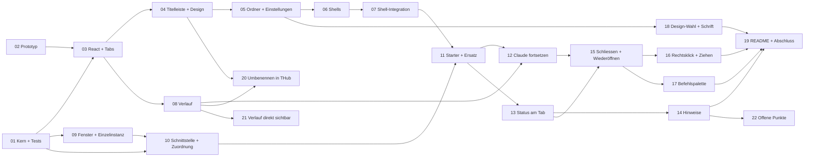

# Tickets für THub 2

Die Tickets zerlegen die [Spezifikation](../specs/termhub-v2.md) in Abschnitte, die sich einzeln umsetzen lassen. Jedes Ticket ist ein durchgehender Schnitt (Kern, Oberfläche, Tests) und lässt sich für sich prüfen.

## Spielregeln

- **AFK** (Status `ready-for-agent`): Ein Agent setzt das Ticket allein um.
  - Er erfüllt die Abschnitte **„Akzeptanzkriterien“**, die alle automatisch oder am Code prüfbar sind, und liefert einen lauffähigen Stand: `npm start`, bei Bedarf ein gebautes Paket.
  - Für den Abschnitt **„Abnahme von Hand“** liefert er eine kurze Prüfliste. Die Abnahme machst du **gesammelt am Schluss** (Ticket 19), nicht nach jedem Ticket. Bis dahin gilt ein Ticket als erledigt, wenn die automatischen Kriterien erfüllt sind und der Stand auf `main` ist.
  - Agenten installieren den Installer nicht über eine bestehende THub-Installation. Zum Prüfen dient das ungepackte Paket (`release/win-unpacked`) bzw. `npm start` mit eigenem Entwicklungs-Datenordner.
- **Der Desktop des Nutzers ist tabu:** Agenten senden keine echten Maus- oder Tastatureingaben, holen keine Fenster in den Vordergrund und ändern keine Systemeinstellungen (auch nicht vorübergehend, etwa das Windows-Design). Geprüft wird über Tests, die Entwicklerwerkzeuge der App (Chrome DevTools Protocol), Fenster-Nachrichten ohne Fokuswechsel (z.B. `WM_NCHITTEST`) und Screenshots per `PrintWindow`. Was sich nur mit echter Bedienung prüfen lässt, kommt in die Prüfliste „Abnahme von Hand“.
- **Shell-Verlauf des Nutzers:** In der echten App nie Befehle in eine PowerShell mit dem echten Profil tippen; sonst landen sie im PSReadLine-Verlauf des Nutzers (`%APPDATA%\Microsoft\Windows\PowerShell\PSReadLine`). Für eigene Starts `APPDATA` und `USERPROFILE` auf einen Temp-Ordner umleiten oder einen cmd-Tab verwenden.
- **Testmodus der App:** Für jede Prüfung der echten App (`npm start`, `electron .` oder die gebaute `THub.exe`) die Umgebungsvariable `THUB_TEST_HIDDEN=1` setzen: Das Fenster öffnet ausserhalb des Bildschirms, ohne Aktivierung und ohne Taskleisten-Eintrag, speichert seine Lage nicht und kommt bei einem zweiten Start nicht nach vorne. „Ordner im Explorer öffnen“ öffnet dann kein Explorer-Fenster, der Ordner steht nur in der Ausgabe; Kopieren und Einfügen benutzen eine eigene Zwischenablage im Speicher statt der echten des Nutzers. Zusätzlich `THUB_TEST_DATA_DIR=<Temp-Ordner>` setzen: Er ersetzt `%APPDATA%` als Wurzel der Datenordner (eigene Daten, eigene Einzelinstanz-Sperre). Ein umgeleitetes `APPDATA` allein genügt nicht, Electron ignoriert es. Die Prüfung nur über CDP auf der eigenen Seite fahren. Ohne `THUB_TEST_HIDDEN=1` und `THUB_TEST_DATA_DIR` die App nie starten.
- **Gebaute App:** Das gepackte `release\win-unpacked\THub.exe` ignoriert `NODE_OPTIONS`; ein Start damit öffnet ein echtes, sichtbares Fenster mit Fokus und legt `%APPDATA%\THub` an. Gepackte Prüfungen nur ohne Fenster (`ELECTRON_RUN_AS_NODE`) oder über einen eigenen Electron-Wrapper, der das Fenster ausserhalb des Bildschirms ohne Aktivierung öffnet.
- **Debug-Ports:** Für die Entwicklerwerkzeuge der App (`--remote-debugging-port`) immer einen zufälligen hohen Port verwenden, nie 9222 oder 9333; auf dem Rechner laufen andere Werkzeuge, die diese Ports nutzen. Nur mit Seiten der eigenen App verbinden.
- **HITL** (Status `ready-for-human`): Das Ticket braucht dich laufend, zum Beispiel für Rückmeldungen.
- Begriffe wie „Workspace-Kern“, „Port“, „Starter“, „Claude-Zuordnung“ oder „Einfrieren“ sind in der Spezifikation erklärt. Vor jedem Ticket die dort genannten Abschnitte lesen.

## Übersicht

| Nr. | Ticket | Typ | Blockiert durch | Stand |
|---|---|---|---|---|
| 01 | [Workspace-Kern mit Tests](01-workspace-kern-mit-tests.md) | AFK | – | erledigt |
| 02 | [Klickbarer Design-Prototyp](02-design-prototyp.md) | HITL | – | erledigt |
| 03 | [React-Oberfläche mit Tab-Leiste](03-react-tab-leiste.md) | AFK | 01, 02 | erledigt |
| 04 | [Titelleiste und Design hell/dunkel](04-titelleiste-design.md) | AFK | 03 | erledigt |
| 05 | [Ordner, Tab-Namen und Einstellungsdialog](05-ordner-und-einstellungen.md) | AFK | 04 | erledigt |
| 06 | [Shells erkennen und pro Tab wählen](06-shells.md) | AFK | 05 | erledigt |
| 07 | [Shell-Integration: Profil, aktueller Ordner, Startbefehl](07-shell-integration.md) | AFK | 06 | erledigt |
| 08 | [Verlauf normaler Tabs sichern und wiederherstellen](08-verlauf.md) | AFK | 03 | erledigt |
| 09 | [Fenster merken und nur eine Instanz](09-fenster-und-einzelinstanz.md) | AFK | 01 | erledigt |
| 10 | [Lokale Schnittstelle, Hook-Datei und Claude-Zuordnung](10-schnittstelle-und-zuordnung.md) | AFK | 01, 09 | erledigt |
| 11 | [Starter und `claude`-Ersatz](11-starter-und-ersatz.md) | AFK | 07, 10 | erledigt |
| 12 | [Claude-Sessions nach einem Neustart fortsetzen](12-claude-fortsetzen.md) | AFK | 08, 11 | erledigt |
| 13 | [Claude-Status und Prozess-Status am Tab](13-status-am-tab.md) | AFK | 11 | erledigt |
| 14 | [Hinweise im Fenster](14-hinweise.md) | AFK | 13 | erledigt |
| 15 | [Tabs schliessen mit Rückfrage und wieder öffnen](15-schliessen-und-wiederoeffnen.md) | AFK | 12, 13 | erledigt |
| 16 | [Rechtsklick-Menü und Umsortieren per Ziehen](16-rechtsklick-und-ziehen.md) | AFK | 15 | erledigt |
| 17 | [Befehlspalette](17-befehlspalette.md) | AFK | 15 | erledigt |
| 18 | [Design-Wahl und Schriftgrösse](18-design-und-schrift.md) | AFK | 05 | erledigt |
| 19 | [README und Abschluss-Prüfung auf einem frischen Rechner](19-readme-und-abschluss.md) | HITL | alle | offen |
| 20 | [Umbenennen in THub](20-umbenennen-thub.md) | AFK | 04, 08 | erledigt |
| 21 | [Verlauf nach dem Neustart direkt sichtbar](21-verlauf-direkt-sichtbar.md) | AFK | 08 | erledigt (verworfen) |
| 22 | [Offene Punkte aus Claudes Antworten als Hinweis](22-offene-punkte.md) | AFK | 14 | erledigt |

**Parallel möglich:**
- 01 und 02 zu Beginn
- 08, 09 und 10 neben der Strecke 04 → 07
- 18, sobald 05 fertig ist
- 12 und 13
- 14 neben 15, danach 16 und 17

Tickets, die gleichzeitig am Workspace-Kern arbeiten, sollten nacheinander zusammengeführt werden.
